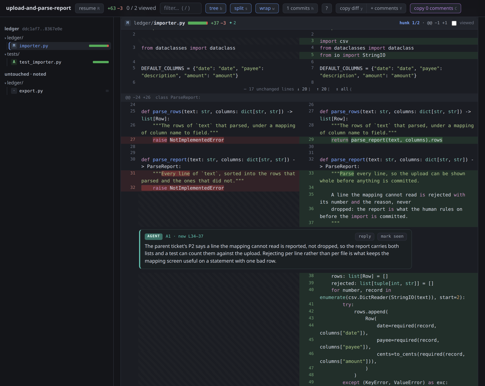

# mx: Agent Workflow Plugin

File-based tickets, domain glossary + ADRs, research artefacts, and session continuity for multi-session work.

<picture>
  <source media="(prefers-color-scheme: dark)" srcset="assets/workflow-map.png">
  
</picture>

<details>
<summary><b>A ticket's life: each status, where it is written, and the command that writes it</b></summary>

<picture>
  <source media="(prefers-color-scheme: dark)" srcset="assets/ticket-life.png">
  
</picture>

</details>

<details>
<summary><b>Grilling across sessions: the ticket, child tickets that need you, and a handoff to a fresh session</b></summary>

<picture>
  <source media="(prefers-color-scheme: dark)" srcset="assets/session-boundary.png">
  
</picture>

</details>

<details>
<summary><b>The board: the tracker as one page</b></summary>

`board`, run from anywhere in the repo, renders every ticket as a row in the group of its state, and everything that waits on you in one group at the top, with its open questions under the row and a copy button on each. A row says what it asks of you, how much of your time it wants and how much it matters, every mark explaining itself on hover, and it opens to the ticket's brief, its questions and its acceptance criteria. A chip hides a whole tree of tickets, a filter narrows the rows, and the column beside them carries a briefing, where things stand and what to pick up next, written by a model that has read the repo, over a preview of the dependency graph that opens full size. An opened ticket also lists the sessions that committed on it, each with the command that resumes it, read off the `Session:` trailer a session's commits carry where a `prepare-commit-msg` hook writes one; a GitHub reference on a row says whether its pull request is open, merged or waiting on changes. It watches the tracker and the open tab re-renders itself, so it stays current while the work is in flight. Screenshots of a demo tracker, rebuilt by [`docs/figures/board-fixture/build.py`](../docs/figures/board-fixture/build.py).

<picture>
  <source media="(prefers-color-scheme: dark)" srcset="assets/board-overview.png">
  
</picture>

One tree of tickets, the rest hidden by their chips; a ticket opened to its question, the sessions that worked on it, its artefacts and its criteria, and the tree's graph beside the rows:

<picture>
  <source media="(prefers-color-scheme: dark)" srcset="assets/board-feature.png">
  
</picture>

</details>

<details>
<summary><b>A ticket's review page: the diff, with the agent's reasoning on the lines it concerns</b></summary>

Every landed ticket gets one, rendered by `dispatch review` and linked from its row on the board: side-by-side diff, keyboard-driven, comments you leave export as markdown to paste back to the agent that wrote the code. The agent's own notes arrive on the page as `AGENT` blocks, anchored to the lines they explain, including on a file the diff left alone deliberately.



</details>

<details>
<summary><b>A landing: from the worker's report to your ruling, with the orchestrator's mark on the hub</b></summary>

The worker's last act is its report: its closing comment, the questions only you can answer, and its assumptions, each anchored to the line of code it shaped. The orchestrator reads the diff against the ticket, imports the report into the ticket, renders the review page, and sorts the build's calls into those you already made, those that are the agent's (how it is built), and those yours to make (anything that changes what you asked for). Only the last reach you, each with the smallest artefact that makes it visible. Every landing also comes with one show of what was built, made by a fork of the orchestrating session, unless the diff alone makes the change plain at a glance.

<picture>
  <source media="(prefers-color-scheme: dark)" srcset="assets/landing.png">
  
</picture>

</details>

<details>
<summary><b>The session page, in the hub tab</b></summary>

Every session you sit at answers on its session page, which the bullet "A session answers on its page" below describes. The [container hub](https://github.com/MaxWolf-01/dotfiles/blob/master/bin/container-hub), a local server in the dotfiles and not part of mx, gathers every session's pages in one browser tab: a rail with one unit per session, its state and the headline of its newest turn, and the selected session's page in a sidebar, with the pages its turns opened in panes beside it, figures and shows on one side, review pages on the other. The box under the session page types into that session's terminal, and hands the session off to a fresh one once its handoff is committed. Screenshots of fictional sessions, rebuilt by [`docs/figures/hub-fixture/build.py`](../docs/figures/hub-fixture/build.py).


</details>

## Artefacts

| Object            | Location                             | Lifecycle                                                             | Content                                                                                                                                                             |
| ----------------- | ------------------------------------ | --------------------------------------------------------------------- | ------------------------------------------------------------------------------------------------------------------------------------------------------------------- |
| Glossary          | `GLOSSARY.md` (repo root)             | durable, edited in place                                              | domain terminology, opinionated, with avoid-lists                                                                                                                   |
| ADR               | `decisions/NNNN-slug.md`             | durable, append-only                                                  | one hard-to-reverse decision and why                                                                                                                                |
| Ticket            | `agent/tickets/<slug>.md`            | `proposed` when an agent filed it, waiting off the frontier for your triage; retired once its tree is finished | one piece of work: its brief, blocking edges and acceptance criteria, plus whatever design it holds. `parent:` makes it the child of another, and a worker reads it with every ancestor |
| Board             | `agent/board.html`                   | gitignored, re-rendered on every tracker change                       | the whole tracker as one page: the needs-me group with its questions, the trees, dependency graphs, frontier, the briefing, review-page links       |
| Research          | `agent/research/NN-slug.md`          | committed; retired with the tickets citing it                         | detail too long for the ticket that asked, cited                                                                                                                    |
| Prototype         | `agent/prototypes/<slug>/`           | committed; retired with the work it served                            | code that answered a design question + `ANSWER.md`                                                                                                                  |
| Show              | `agent/show/<slug>/`, `<branch>/`    | committed with the round or the landing that made it; retired with the ticket or branch it served | an explanation carried by an artefact                                                                                                                               |
| Handoff           | `agent/handoffs/YYYY-MM-DD-slug.md`  | committed; retired by the session that picks it up                    | a session compacted for a fresh one to start from                                                                                                                  |

`/mx:tracker` defines the file conventions (status, blocked-by, frontier, claiming, the board); the tracker lives in the agent repo, which is a git repo of its own at the project's `agent/`.

## The main flow: intent → ship

The gate picks the first thing you judge: the session drafts the ticket, builds it when the intent has one sensible shape, prototypes the rivals when it has several, and grills it when no brief can be written yet (`/mx:grilling`: relentless interview; each round delivers the design whole and writes it to the ticket; glossary terms and ADRs land as residue). Then the cut into child tickets (tracer-bullet vertical slices with blocking edges, as soon as the interview has no question left for you; `/mx:tracker`) → `/mx:dispatch` works them: a fresh worker per ticket, its contract the prompt dispatch appends to it (testing inside, code-review at the end), serial or in waves, the board as the standing view. Work that is one slice stays one ticket and is dispatched as it is.

**`/mx:orient` is the map**: the gate, the question that routes an intent to loose work or a ticket, the main flow, its on-ramps, and when to reach for what.

Planning that outgrows one session keeps its artefacts: the open questions leave as child tickets that need you, the next session claims one and grills it, and the ticket grows until its frontier is empty.

## What's manual, what's AFK, and why

- **Grilling is where alignment happens on fog**: an intent too unclear to brief is grilled with you in the loop, non-negotiable, until the ticket can be written and a sensible first version built; `/mx:grilling` says what its questions lean to. Everything downstream trades on the shared understanding built there. An intent with one sensible shape skips it: you rule on the build, since a call is judged best in front of the concrete thing, and nothing merges before you do. A call the build rests on that you may want to set is named when it starts; answer it while it runs, or when the landing shows it to you. External inputs (a meeting transcript, a client brief, a bug report) pass the gate like any intent: the foggy ones are grilled through their unstated assumptions.
- **Plan in one window, respect the smart zone.** Grilling (which writes the ticket) → the cut into child tickets stays in one unbroken context window; but reasoning degrades noticeably from roughly 30% of the window used, regardless of advertised size. Approaching the limit mid-planning → end the session with the frontier open (the sharp questions become child tickets that need you) or handoff to a fresh thread; don't push on degraded.
- **The design is reviewed as it is written.** A wrong line of code is one wrong line; a wrong line in the design becomes hundreds of them, so the ticket is where a look pays most. Grilling writes it round by round and you review each round as it lands, the ticket in front of the figures that explain it, both linked from the round's turn on the session page (`/mx:grilling` has the mechanics); writing it down is itself a design step. A ticket assembled across sessions gets one whole-document read before it is cut, for drift between sessions.
- **The ticket breakdown is the agent's.** How a ticket is cut is the agent's call: the cut files the slices `open`, checks their shape itself (vertical, sized to one worker), and the workers start. You judge the built tree at its close-out, which is where a slice too coarse to demo shows up anyway.
- **Proposed tickets wait for your triage.** What an agent files on its own reading (a worker's friction, a review finding, a punt) is `proposed` and stays off the frontier, so the pile gets read together and a pattern across several tickets shows. You start a triage when you want one (`/mx:triage`): the pile is grouped by shared cause, and you drop, merge or promote each ticket. Your own "build this" makes a ticket open at once.
- **The build runs while you are away.** It starts when the interview has no question left for you; every call you have not ruled on stays marked in its ticket, or is an anchored assumption on the review page where a worker made it. A build carrying calls you have not made that change what you asked for waits for your ruling (accept, amend, redo or reject), and you are shown those calls alone, each with the artefact that makes it visible; one carrying none merges into its parent ticket's branch on your standing yes, and into the integration branch only on your word: a ship, merge or accept you give once you have seen it, or up front for a change you named yourself. Either way the landing comes with a show of what was built, for whenever you look, unless the diff alone makes the change plain at a glance. Nothing merges above a parent ticket's branch before you rule. You rule a parent ticket whole, with its children, at its close-out: a child merges into the parent's branch once the orchestrator has read it, and its siblings build on it unruled. A hinge, a child its dependents would have to be rewritten around were it wrong, you rule alone, and its dependents start only after you accept it.
- **Implementation is the AFK part.** Day shift plans and cuts the tickets; night shift works the frontier, fresh context per ticket.
- **QA is where you impose taste, per landed slice.** Manual, deliberately: automate the idea, the planning, *and* the QA and you get slop. Every ticket is a tracer bullet, drivable the moment it lands: the worker builds, tests and reports, and the landing hands you its review page and, unless the diff alone makes the change plain at a glance, one show of what was built, made by a fork of the session that lands it (`/mx:show`). The show opens with the intent and how the parts fit, goes a level lower only where the one above needs it, and a script it leaves that runs the thing gets a button on the ticket's board row; you drive what you want to on your own machine while the remaining frontier keeps running (`dispatch ps` lists every worker on every host, `dispatch peek <slug>` prints one's pane and `dispatch attach <slug>` takes it). Findings become new tickets with blocking edges; the board absorbs them.
- **Reviews run in fresh context.** A reviewer sharing the implementer's window reviews in the dumb zone; a worker closes with code-review in clean context for a reason.
- **A session answers on its page.** Every session you sit at has a page from its first reply, one browser page per session with the questions waiting on you at the top and the turns below, newest first, each linking the artefacts it made. A turn that delivers something (an answer, an artefact, a question, a landing) writes it there as a turn record; a turn that only reports where it stands ends on a line or two in the chat, which the page shows as a chat turn. A turn that writes a record ends on a chat recap of what waits on you, as action items, one plain line each that never points at the page; the questions themselves stay on the page. As the turn ends the Stop hook opens every artefact the turn linked in your browser, and the page with them the first time, or on every turn where the container hub runs (see "The session page, in the hub tab" above). Under the recap it shows one line of its own: the questions waiting on you and the link to the page. When the session ends, a hook commits its records (not the page, which re-renders from them) to the agent repo in a commit of their own, so what a session reported and asked outlives it. The agent writes plain-text turn records and hands every artefact to a subagent or a fork, so no HTML and no render loop fills its context (`mx/skills/session-page/RULES.md`, which `claude/CLAUDE.md` imports into every session).
- **A session page's prose has a reviewer too.** A turn that writes a record for its session page gets one light review the moment the record is written: a model reads it against the chat-scoped rules of `/mx:writing-for-humans`'s catalogue, seeing what you have seen on the page, and hands a few findings back while the turn still runs, so the session revises the record before it writes its recap. It fails open, stays out of a dispatched worker's session, and logs every decision; `mx/skills/session-page/turn_review.py` says where the log goes.
- **Feedback loops are the ceiling.** Agent output quality tracks the quality of the repo's tests and typechecks. Bad output → improve the loops, not the prompt (`/mx:improve-codebase-architecture`; deep modules: design the interface, delegate the implementation).
- **A test earns its place, and the full-path checks run on purpose.** A test holds a behaviour you rely on, pins a bug that reached you, or states an invariant of a seam; one doing none of those is deleted, and one that flakes is fixed or deleted the day it flakes (`/mx:testing`). `make test` is the fast suite every change runs; the full-path checks drive the real thing (a browser on the page, tmux, a paid API) and run when work reaching their path lands, and before a release. Property tests come with architecture work, where stating a seam's invariant is how the seam gets clear; a ticket's properties are prose each review checks the diff against. You read one debrief per tree beside the diff and rule on its proposals: anything an agent files on its own reading is `proposed`, and waits for your triage.
- **Done work gets deleted** (`git rm`). Closed tickets left in the tree are doc rot steering future agents wrong; git history keeps them.

## Skills & commands

| | |
| --- | --- |
| `/mx:orient` | the router; start here |
| `/mx:grilling` | sharpen a plan by interview; the design lands in the ticket as it settles |
| `/mx:domain-modelling`, `/mx:codebase-design` | vocabulary layers: domain language + ADRs, deep-module design |
| `/mx:testing`, `/mx:code-review` | what makes a test worth keeping, and when the full-path checks run; four-axis review |
| `/mx:dispatch` | work a ticket and its children: one orchestrator, a fresh worker per ticket, serial or in waves |
| `/mx:prototype` | throwaway code when shapes are rivals or one has to be driven to be judged |
| `/mx:triage` | the proposed tickets grouped by cause, and each dropped, merged or promoted |
| `/mx:to-questionnaire` | turn a decision someone else must answer into a questionnaire for them |
| `/mx:wizard` | bash wizard walking a human through steps only they can do (credentials, dashboards, migrations) |
| `/mx:wait-what` | that didn't land; re-pitch it in plain language |
| `/mx:show` | show, don't tell; explain via artifact (diagram, comparison, demo, explainer page, …) |
| `/mx:fork` | delegate to an agent that inherits the full conversation |
| `/mx:diagnosing-bugs` | tight-loop debugging for hard bugs |
| `/mx:improve-codebase-architecture`, `/mx:bloat-audit` | codebase health |
| `/mx:research` | primary-source investigation → findings on the ticket that asked |
| `/mx:codex` | second opinion from a different model |
| `/mx:handoff`, `/mx:transcript`, `/mx:recap` | session continuity & status |
| `/mx:writing-for-agents`, `/mx:writing-for-humans` | the writing references: documents that instruct agents (skills, CLAUDE.md, tickets) / artifact text read cold (docs, comments, UI copy) |

Plus assorted utilities: `tmux`, `mermaid`, `tyro-cli`, `project-setup`, `ml`, `house-style`, `session-name`, `restore-sessions`, `permissions-review`, `review-pr`, `github`, `gh-stack`, `expert`, `changelog`, `dependabot-triage`.

---

**Local development:**

```bash
rm -rf ~/.claude/plugins/cache/MaxWolf-01/mx/0.1.0
ln -s /path/to/mx ~/.claude/plugins/cache/MaxWolf-01/mx/0.1.0
```

`claude plugin update mx@MaxWolf-01` replaces the symlink.
