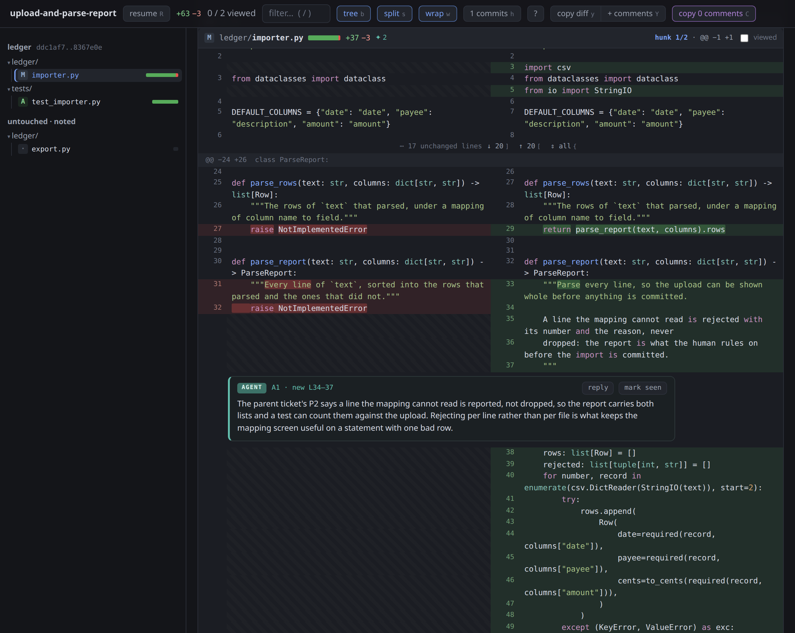

# mx: Agent Workflow Plugin

mx is a Claude Code plugin for working with many agents at once and keeping the overview. Its parts:

- **Skills**, one directory each under [`skills/`](skills/). A knowledge skill holds in any chat with any model (how to show a thing, how to write, how to test); a workflow skill runs this setup's machinery; a skill that is both keeps its workflow text in a `WORKFLOW.md` beside its `SKILL.md`.
- **The tracker**: file-based tickets in an agent repo at the project's `agent/`, and the board, which renders them as one page.
- **Dispatch**: one orchestrator hands each ticket to a fresh worker in a worktree of its own, on this machine or another, and lands what comes back.
- **The review page and the show**: a landing reaches you as a diff with the agent's reasoning on the lines it concerns, which `diffview` renders and the plugin assumes on the machine, and, unless the diff makes the change plain, a page explaining what was built.
- **The session page**: one page per session you sit at, with what waits on you at the top.
- **Commands and hooks**: the scripts under [`bin/`](bin/) that skills call, and the hooks in [`hooks/hooks.json`](hooks/hooks.json) that keep the session page and the context checkpoint current.

Tests, the `tracker` and `dispatch` scripts, which refuse what the rules forbid, and a reviewer in a fresh context catch what a machine can check; what needs you is put in front of you as something to look at, at a few numbered stops.

**[The mx workflow, told in its figures](https://share.mwolf.dev/cd2d28458796da026853498ac22481f3/)**: one page that walks through the figures below in order, each growing a step at a time.

<picture>
  <source media="(prefers-color-scheme: dark)" srcset="assets/workflow-map.png">
  
</picture>

## Layout

- [`.claude-plugin/plugin.json`](.claude-plugin/plugin.json): the version every machine installs by; `make release-patch` in the repo root bumps it.
- [`CHANGELOG.md`](CHANGELOG.md): one section per release; a session moved to a newer mx reads the sections it skipped.
- [`bin/`](bin/): the commands skills call, on PATH in every session with the plugin enabled, each running the script in its skill and answering `--help`.
- [`hooks/`](hooks/): `hooks.json`, which wires the session page, the context checkpoint and the update notice to session events.
- [`skills/`](skills/): one directory per skill, listed by kind under [Skills](#skills), plus `session-page/`, the scripts and rules behind the session page. [`skills/show/mermaid/`](skills/show/mermaid/) and [`skills/show/struktogramm/`](skills/show/struktogramm/) are skills inside a skill: `show` points to them for Mermaid diagrams, validated with Pele, and for Nassi-Shneiderman diagrams; Claude Code does not list them, and each folder imports into claude.ai as it stands.
- [`assets/`](assets/): the images this README embeds, rendered from [`../docs/figures/`](../docs/figures/).
- [`docs/`](docs/): how the parts work in depth.
- `test_*.py`: checks over every skill and script, run by `make check` in the repo root.

<details>
<summary><b>The commands in <code>bin/</code></b></summary>

- `tracker`, `board`: the tickets and the page that shows them (`/mx:tracker`).
- `dispatch`: the orchestrator's side of dispatch (`/mx:dispatch`).
- `review`: the reviewers of one code review (`/mx:code-review`).
- `session-page`: the session page of the session that runs it.
- `render-lint`, `browsers`, `blind-test`: lint a rendered page, list or kill the browsers a run launched, and render a blind test (`/mx:show`, `/mx:grilling`).
- `glossary-lint`: check a `GLOSSARY.md` (`/mx:domain-modelling`).
- `change-summary`: a cold reader's summary of a diff, for a PR (`/mx:github`).
- `model-runs`, `retro`: the log of model runs, and the retro that reads it.

</details>

## How a piece of work goes through

`/mx:orient` is the flow; in short:

1. **You state an intent** in a session. It drafts a ticket, and the draft picks the first thing you judge.
2. **The draft picks the route.** An intent with one sensible shape is built and you judge the build. One with rival shapes gets a prototype, or a figure per rival (`/mx:prototype`). One too foggy to brief is grilled: each round delivers the design whole and writes it to the ticket, and glossary terms and ADRs land as it goes (`/mx:grilling`). The pick comes back whenever a build misses or a new question appears.
3. **The ticket is cut** into child tickets, vertical slices with blocking edges, where a child's worker needs little of the others' context (`/mx:tracker`). Work that is one slice stays one ticket.
4. **Dispatch works the tickets** (`/mx:dispatch`): a fresh worker per ticket, serial or in parallel, testing as it goes and closing with a code review in a fresh context.
5. **The landing** brings you the review page, a show of what was built, and only the calls that are yours to make. You accept, amend, redo or reject.
6. **QA is yours.** You drive what landed; your findings become tickets, and a decision you reopen goes back to grilling.

Planning that outgrows one session keeps its artefacts: the open questions leave as child tickets that need you, the next session claims one and grills it, and the ticket grows until its frontier is empty.

<details>
<summary><b>A ticket's life: each status, where it is written, and the command that writes it</b></summary>

<picture>
  <source media="(prefers-color-scheme: dark)" srcset="assets/ticket-life.png">
  
</picture>

</details>

<details>
<summary><b>Grilling across sessions: the ticket, child tickets that need you, and a handoff to a fresh session</b></summary>

<picture>
  <source media="(prefers-color-scheme: dark)" srcset="assets/session-boundary.png">
  
</picture>

</details>

<details>
<summary><b>A landing: from the worker's report to your ruling, with the orchestrator's mark on the hub</b></summary>

The worker's last act is its report: its closing comment, the questions only you can answer, and its assumptions, each anchored to the line of code it shaped. The orchestrator reads the diff against the ticket, imports the report into the ticket, renders the review page, and sorts the build's calls into those you already made, those that are the agent's (how it is built), and those yours to make (anything that changes what you asked for). Only the last reach you, each with the smallest artefact that makes it visible. Every landing also comes with one show of what was built, made by a fork of the orchestrating session, unless the diff alone makes the change plain at a glance.

<picture>
  <source media="(prefers-color-scheme: dark)" srcset="assets/landing.png">
  
</picture>

</details>

<details>
<summary><b>A ticket's review page: the diff, with the agent's reasoning on the lines it concerns</b></summary>

Every landed ticket gets one, rendered by `dispatch review` and linked from its row on the board: side-by-side diff, keyboard-driven, comments you leave export as markdown to paste back to the agent that wrote the code. The agent's own notes arrive on the page as `AGENT` blocks, anchored to the lines they explain, including on a file the diff left alone deliberately.



</details>

## Where you come in

- **Grilling**, when an intent is too foggy to brief.
- **Your ruling** on a landing that carries calls you have not made.
- **QA**, by hand, per landed slice.
- **A triage** of the tickets agents filed on their own reading, when you start one (`/mx:triage`).

Everything else runs while you are away. [`docs/why.md`](docs/why.md) says what is manual, what runs unattended, and why.

## What waits on you

The board and the session page are where you look.

<details>
<summary><b>The board: the tracker as one page</b></summary>

`board`, run from anywhere in the repo, renders every ticket as a row in the group of its state, and everything that waits on you in one group at the top, with its open questions under the row and a copy button on each. A row says what it asks of you, how much of your time it wants and how much it matters, every mark explaining itself on hover, and it opens to the ticket's brief, its questions and its acceptance criteria. A chip hides a whole tree of tickets, a filter narrows the rows, and the column beside them carries a briefing, where things stand and what to pick up next, written by a model that has read the repo, over a preview of the dependency graph that opens full size. An opened ticket also lists the sessions that committed on it, each with the command that resumes it, read off the `Session:` trailer a session's commits carry where a `prepare-commit-msg` hook writes one; a GitHub reference on a row says whether its pull request is open, merged or waiting on changes. It watches the tracker and the open tab re-renders itself, so it stays current while the work is in flight. Screenshots of a demo tracker, rebuilt by [`docs/figures/board-fixture/build.py`](../docs/figures/board-fixture/build.py).

<picture>
  <source media="(prefers-color-scheme: dark)" srcset="assets/board-overview.png">
  
</picture>

One tree of tickets, the rest hidden by their chips; a ticket opened to its question, the sessions that worked on it, its artefacts and its criteria, and the tree's graph beside the rows:

<picture>
  <source media="(prefers-color-scheme: dark)" srcset="assets/board-feature.png">
  
</picture>

</details>

<details>
<summary><b>The session page, in the hub tab</b></summary>

Every session you sit at answers on its session page, which [docs/why.md](docs/why.md) describes under "A session answers on its page". The [container hub](https://github.com/MaxWolf-01/dotfiles/blob/master/bin/container-hub), a local server in the dotfiles and not part of mx, gathers every session's pages in one browser tab: a rail with one unit per session, its state and the headline of its newest turn, and the selected session's page in a sidebar, with the pages its turns opened in panes beside it, figures and shows on one side, review pages on the other. The box under the session page types into that session's terminal, and hands the session off to a fresh one once its handoff is committed. A screenshot of fictional sessions, rebuilt by [`docs/figures/hub-fixture/build.py`](../docs/figures/hub-fixture/build.py).


</details>

## Where a project's artefacts live

| Object            | Location                             | Lifecycle                                                             | Content                                                                                                                                                             |
| ----------------- | ------------------------------------ | --------------------------------------------------------------------- | ------------------------------------------------------------------------------------------------------------------------------------------------------------------- |
| Glossary          | `GLOSSARY.md` (repo root)             | durable, edited in place                                              | domain terminology, opinionated, with avoid-lists                                                                                                                   |
| ADR               | `decisions/NNNN-slug.md`             | durable, append-only                                                  | one hard-to-reverse decision and why                                                                                                                                |
| Ticket            | `agent/tickets/<slug>.md`            | `proposed` when an agent filed it, waiting off the frontier for your triage; retired once its tree is finished | one piece of work: its brief, blocking edges and acceptance criteria, plus whatever design it holds. `parent:` makes it the child of another, and a worker reads it with every ancestor |
| Board             | `agent/board.html`                   | gitignored, re-rendered on every tracker change                       | the whole tracker as one page: the needs-me group with its questions, the trees, dependency graphs, frontier, the briefing, review-page links       |
| Research          | `agent/research/NN-slug.md`          | committed; retired with the tickets citing it                         | detail too long for the ticket that asked, cited                                                                                                                    |
| Prototype         | `agent/prototypes/<slug>/`           | committed; retired with the work it served                            | code that answered a design question + `ANSWER.md`                                                                                                                  |
| Show              | `agent/show/<slug>/`, `show/` in the session's directory (`session-page`) | committed with the round or the landing that made it, a session's into `agent/sessions/<id>/show/` as it ends; a ticket's retired with it | an explanation carried by an artefact                                                                                                                               |
| Handoff           | `agent/handoffs/YYYY-MM-DD-slug.md`  | committed; retired by the session that picks it up                    | a session compacted for a fresh one to start from                                                                                                                  |
| Retro             | `agent/retro/`                       | durable; rewritten whole by every retro run                           | the tracker's living report, over every repo it plans, and the page built from it |

`/mx:tracker` defines the file conventions (status, blocked-by, frontier, claiming, the board); the tracker lives in the agent repo, which is a git repo of its own at the project's `agent/`.

## Skills

### Knowledge

A `SKILL.md` that holds in any chat, with no tickets, session page or dispatch.

| Skill | What it is for |
| --- | --- |
| [`/mx:attack-the-premise`](skills/attack-the-premise/SKILL.md) | question the premise two failed attempts shared, before a third |
| [`/mx:benchmark-checklist`](skills/benchmark-checklist/SKILL.md) | vet a perf measurement before reporting or acting on it |
| [`/mx:bloat-audit`](skills/bloat-audit/SKILL.md) | whole-repo over-engineering audit: what to delete, simplify or replace |
| [`/mx:changelog`](skills/changelog/SKILL.md) | update CHANGELOG.md with what changed since the last release |
| [`/mx:codebase-design`](skills/codebase-design/SKILL.md) | the deep-module vocabulary: interfaces, seams, depth |
| [`/mx:dependabot-triage`](skills/dependabot-triage/SKILL.md) | Dependabot alerts: real impact or noise |
| [`/mx:diagnosing-bugs`](skills/diagnosing-bugs/SKILL.md) | the diagnosis loop for hard bugs and regressions |
| [`/mx:domain-modelling`](skills/domain-modelling/SKILL.md) | the glossary and ADRs: a project's domain language and its hard-to-reverse decisions |
| [`/mx:gh-stack`](skills/gh-stack/SKILL.md) | stacked PRs with `gh stack` |
| [`/mx:github`](skills/github/SKILL.md) | issues and PRs written under your name |
| [`/mx:house-style`](skills/house-style/SKILL.md) | the look of your own pages and tools |
| [`/mx:ml`](skills/ml/SKILL.md) | ML project conventions: experiments, tracking, tensor code |
| [`/mx:prototype`](skills/prototype/SKILL.md) | throwaway code when shapes are rivals or one has to be driven to be judged |
| [`/mx:recap`](skills/recap/SKILL.md) | where the work stands: findings, decisions, open questions |
| [`/mx:research`](skills/research/SKILL.md) | primary-source investigation of a question a decision waits on |
| [`/mx:session-name`](skills/session-name/SKILL.md) | a `/rename` for the session |
| [`/mx:sharpen`](skills/sharpen/SKILL.md) | aim the work at what the best expert would do |
| [`show/mermaid`](skills/show/mermaid/SKILL.md) | Mermaid diagrams, validated with Pele before they go anywhere; reached from `/mx:show`, not invoked by name |
| [`show/struktogramm`](skills/show/struktogramm/SKILL.md) | a procedure drawn as a Nassi-Shneiderman diagram; reached from `/mx:show`, not invoked by name |
| [`/mx:testing`](skills/testing/SKILL.md) | what makes a test worth keeping, and the fast suite against the full-path checks |
| [`/mx:to-questionnaire`](skills/to-questionnaire/SKILL.md) | turn a decision someone else must answer into a questionnaire |
| [`/mx:tyro-cli`](skills/tyro-cli/SKILL.md) | Python CLIs with tyro, and `uv run` scripts |
| [`/mx:unslop`](skills/unslop/SKILL.md) | the writing-for-humans pass over a file, a diff or a message |
| [`/mx:verify`](skills/verify/SKILL.md) | make a change fully verifiable |
| [`/mx:wait-what`](skills/wait-what/SKILL.md) | that did not land; re-pitch it in plain language |
| [`/mx:wizard`](skills/wizard/SKILL.md) | a bash wizard that walks a human through steps only they can do |
| [`/mx:writing-for-agents`](skills/writing-for-agents/SKILL.md) | writing documents agents read: skills, AGENTS.md, tickets |
| [`/mx:writing-for-humans`](skills/writing-for-humans/SKILL.md) | writing artifact text read cold: docs, comments, UI copy, commits |

### Both

Knowledge in `SKILL.md`, and in `WORKFLOW.md` beside it what is particular to that skill in the workflow, which `claude/CLAUDE.md` tells every session to read with it.

| Skill | What it is for |
| --- | --- |
| [`/mx:grilling`](skills/grilling/SKILL.md) | sharpen a plan by interview, round by round; in the workflow the design lands in a ticket |
| [`/mx:improve-codebase-architecture`](skills/improve-codebase-architecture/SKILL.md) | scan for deepening opportunities; in the workflow they go into the living report |
| [`/mx:project-setup`](skills/project-setup/SKILL.md) | a project's foundations; in the workflow also its agent repo and the tracker's hooks |
| [`/mx:show`](skills/show/SKILL.md) | show, don't tell: a figure, a diagram, a demo, an explainer page; in the workflow, a landing's show |

### Workflow

The workflow's own machinery.

| Skill | What it is for |
| --- | --- |
| [`/mx:orient`](skills/orient/SKILL.md) | the flow from intent to merge; start here |
| [`/mx:tracker`](skills/tracker/SKILL.md) | the ticket tree: filing, claiming, ruling, retiring, and the board |
| [`/mx:dispatch`](skills/dispatch/SKILL.md) | work a ticket and its children: one orchestrator, a fresh worker per ticket |
| [`/mx:code-review`](skills/code-review/SKILL.md) | a review of a branch by reviewers in fresh context |
| [`/mx:review-pr`](skills/review-pr/SKILL.md) | code-review driven against a GitHub PR |
| [`/mx:triage`](skills/triage/SKILL.md) | the proposed tickets grouped by cause, and only the design calls put to you |
| [`/mx:retro`](skills/retro/SKILL.md) | the repo's living report, kept by a weekly retro |
| [`/mx:fork`](skills/fork/SKILL.md) | delegate to an agent that inherits the whole conversation |
| [`/mx:handoff`](skills/handoff/SKILL.md) | compact the session into a file a fresh one starts from |
| [`/mx:pickup`](skills/pickup/SKILL.md) | start a session from a handoff |
| [`/mx:wrap`](skills/wrap/SKILL.md) | close a session |
| [`/mx:codex`](skills/codex/SKILL.md) | a second opinion from a different model family |
| [`/mx:tmux`](skills/tmux/SKILL.md) | run what might not come back on its own in tmux |
| [`/mx:model-runs`](skills/model-runs/SKILL.md) | the log of every `claude -p` the workflow starts |
| [`/mx:restore-sessions`](skills/restore-sessions/SKILL.md) | find the sessions with unfinished work |

`/mx:writing-for-agents`'s `SKILL-MECHANICS.md` holds the convention and its test.

---

**Local development:**

```bash
rm -rf ~/.claude/plugins/cache/MaxWolf-01/mx/0.1.0
ln -s /path/to/mx ~/.claude/plugins/cache/MaxWolf-01/mx/0.1.0
```

`claude plugin update mx@MaxWolf-01` replaces the symlink.
